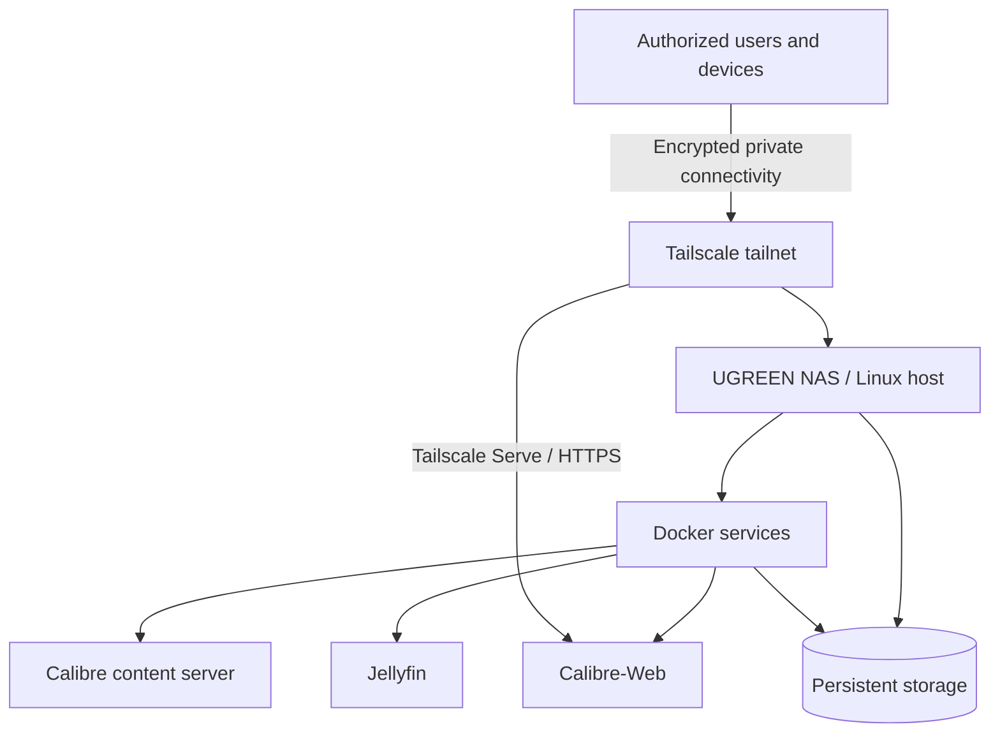

# Home Lab | Infrastructure for Accessible Knowledge

**Self-hosted infrastructure centered on accessible resources, digital independence, and responsible data stewardship.**

I operate self-hosted media and digital-library services for a **small community** through **Jellyfin** and **Calibre-Web**. I manage the infrastructure behind those services, including the UGREEN NAS, Docker containers, Linux administration, and the **Calibre backend** that supports the digital library.

This is an actively used, community-facing environment—not just a demonstration or proposed service. Its purpose is to help people access and organize shared digital resources while giving me direct responsibility for the systems that support them. Specific services may still require authentication or private-network access; community-facing does not mean every endpoint is publicly exposed.

## At a glance

| Area | Implementation | Engineering focus |
| --- | --- | --- |
| Host | UGREEN NAS | Storage, administration, service hosting |
| Containers | Docker | Deployment, isolation, persistent volumes |
| Digital library | Calibre and Calibre-Web | Collection organization and multi-device access |
| Media | Jellyfin | Self-hosted media management |
| Private connectivity | Tailscale | Encrypted access across trusted devices |
| Secure web access | Tailscale Serve (HTTPS) | Reverse proxy and service exposure boundaries |
| Operations | Linux, SSH | Configuration, diagnosis, maintenance |

## Why this project exists

Access to information depends on more than an application interface. It also depends on storage, network availability, maintainability, portability, and the choices made about who controls data. I apply these principles while operating services for real community members, balancing usability with the responsibility of maintaining their supporting infrastructure.

My guiding principles:

- **Accessibility:** Make appropriately authorized digital resources easier for community members to access across devices.
- **Stewardship:** Treat digital collections as resources worth organizing and preserving.
- **Independence:** Understand and control the infrastructure supporting those resources.
- **Privacy and security:** Favor authenticated private access over unnecessary public exposure.
- **Transferable learning:** Build and document infrastructure with real community use and relevance to libraries, education, and other resource-sharing initiatives.

## Architecture

See [the architecture overview](architecture/README.md) for a diagram and trust-boundary notes. The diagram is intentionally conceptual; it excludes private addresses, credentials, and internal host details.

## Technical case studies

### 1. A community-facing digital library

I deployed Calibre and Calibre-Web as containerized services on my NAS, using persistent storage to manage digital book collections. **I administer the Calibre backend**, while community members access library resources through Calibre-Web. This project involved distinguishing the Calibre content server from the Calibre-Web frontend, configuring container ports and volumes, and testing connectivity.

**Skills demonstrated:** Docker configuration, persistent volumes, service architecture, troubleshooting, and digital collection management.

[Read the case study](docs/digital-library.md)

### 2. Private remote access with HTTPS

I connected trusted devices through Tailscale and configured Tailscale Serve to proxy Calibre-Web over HTTPS within my private tailnet. This provided a practical lesson in service binding, container networking, encrypted access, and the difference between local service ports and externally reachable endpoints.

**Skills demonstrated:** Private networking, Linux CLI, SSH, reverse proxies, HTTPS, and security boundaries.

[Read the case study](docs/private-access.md)

### 3. Media services and operational ownership

I operate Jellyfin in Docker as a media service used by a small community. Maintaining the service alongside other applications provides hands-on experience with container lifecycle management and the operational tradeoffs of managing resources independently.

**Skills demonstrated:** Container operations, Linux administration, and application maintenance.

[Read the operations notes](docs/operations.md)

## Tools and technologies

**Docker · Linux · SSH · Tailscale · HTTPS · Reverse proxying · NAS storage · Jellyfin · Calibre · Calibre-Web · Networking / DNS**

## Security and documentation approach

This repository documents architecture and lessons learned, **not live credentials or deployable copies of my private configuration**. Sensitive addresses, host identifiers, authentication details, API keys, and personal media or book collections are intentionally excluded. Any example configuration must use placeholders.

## Roadmap

- [x] Deploy multiple containerized services on a NAS
- [x] Establish private access using Tailscale
- [x] Configure HTTPS access to Calibre-Web through Tailscale Serve
- [x] Document core architecture and technical case studies
- [ ] Add sanitized, reproducible Docker Compose examples
- [ ] Document a tested backup and recovery procedure
- [ ] Add monitoring and service-health documentation
- [ ] Explore ways to expand access to appropriately licensed or public-domain resources

## Related projects

- [sunBEAR](https://github.com/lux042/sunBEAR) — cross-platform archival research tooling
- [Pocket sunBEAR](https://github.com/lux042/pocket-sunBEAR) — mobile research collection and exports
- [JFK Reader](https://github.com/lux042/JFK-Reader) — document retrieval and question-answering across archival records
- [Forage](https://github.com/lux042/forage) — location-aware restaurant discovery and journaling

---

Built and documented by [lux042](https://github.com/lux042). This repository documents community-facing infrastructure. Access to individual services is governed by their own permissions and availability.