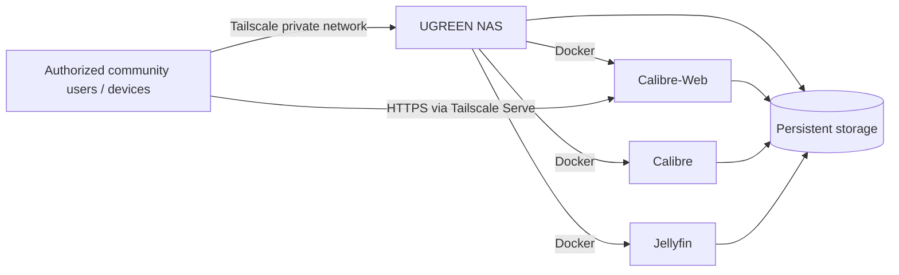

# Architecture and trust boundaries

This is a **conceptual** overview of the current home lab. The project serves a community-facing purpose; this diagram documents the confirmed private-network access path, not every possible access method.

## Boundaries

- **Clients:** This diagram covers authorized devices using the private tailnet. Other community access arrangements have not yet been documented.
- **Host:** The NAS runs services and stores application data.
- **Containers:** Applications have separate runtime configurations and persistent storage mappings.
- **HTTPS endpoint:** Tailscale Serve proxies Calibre-Web for tailnet access; this particular endpoint is tailnet-only; that does not define the accessibility of the whole project.

## To verify before publishing more detail

Confirm container-to-host port mappings, storage paths, backup strategy, and access-control policies before adding sanitized configurations. Do not publish private addresses, credentials, device identifiers, or personal collection contents.