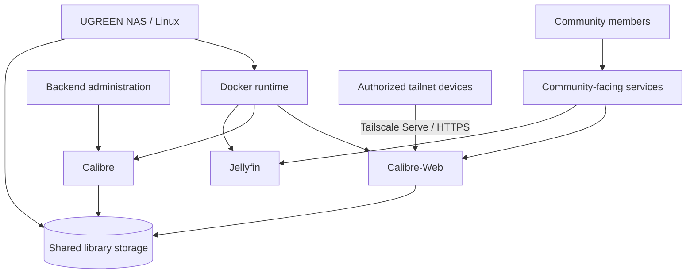

# Architecture and access boundaries

This conceptual diagram distinguishes the **community-facing interfaces** from the **Calibre backend that I administer**. It documents a verified Tailscale access path without implying that every community member necessarily uses that path.

## What is confirmed

- A UGREEN NAS hosts Docker-based Jellyfin, Calibre, and Calibre-Web services.
- A small community uses Jellyfin and Calibre-Web.
- I administer the Calibre backend.
- Tailscale Serve provides an HTTPS path to Calibre-Web within the private tailnet.
- The services use persistent storage.

## Access and security boundaries

Community-facing means that people actually use the services; it **does not** imply anonymous public access. The diagram shows the documented private-network route separately from the community-facing service relationship. Other community access methods are not specified here.

Before adding deployment instructions, verify actual access controls, service mappings, and backup procedures. Never publish credentials, private network addresses, device identifiers, or community members' personal information.
